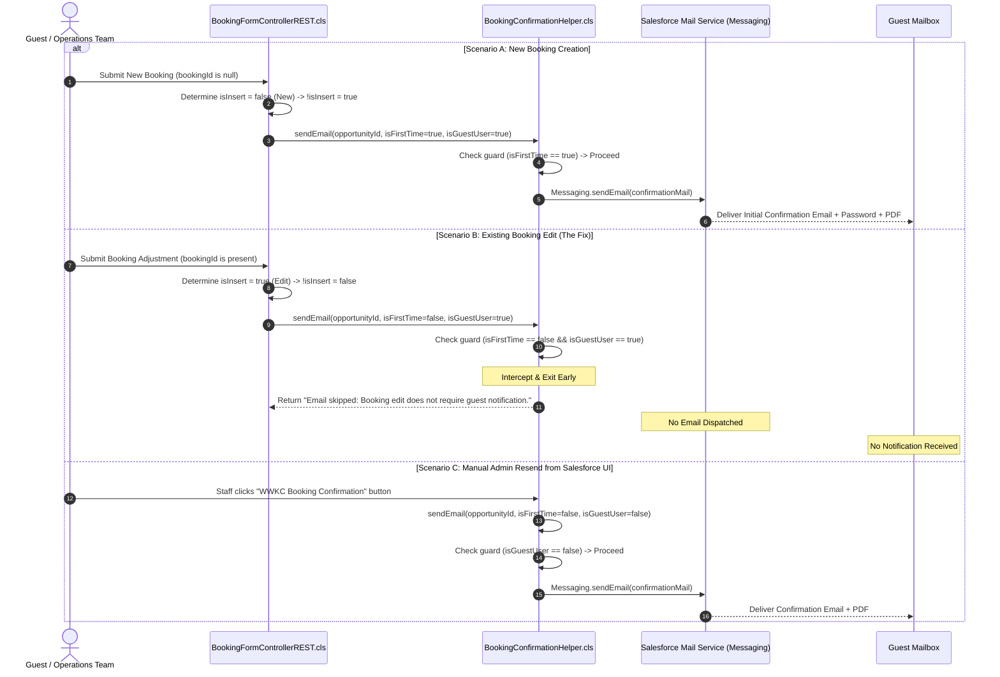

# Low-Level Design (LLD): Booking Edit Email Notification Suppression

## 1. Executive Summary & Problem Statement

### 1.1 Business Context
In Worldwide Kids (WWK), childcare bookings are created and managed by guests and internal operational teams (reservations, childcare managers, reception staff). During the lifecycle of a booking, teams regularly make routine operational adjustments—such as changing session times, reassigning children, extending dates, or updating notes.

### 1.2 Problem Statement
Previously, every time an existing booking was edited or adjusted through the booking system, Salesforce automatically triggered and dispatched a full "Childcare Booking Confirmation" email (including temporary passwords and PDF attachments) to the guest's inbox. This caused significant guest confusion, inbox clutter, and increased support inquiries.

### 1.3 Solution Objective
Suppress automated email notifications to guests when an existing booking is updated or edited, while ensuring:
1. **Initial Bookings:** First-time booking creation continues to trigger the full confirmation email, credentials, and attachments as normal.
2. **Manual Staff Resends:** Internal staff can still manually trigger a confirmation email from Salesforce if explicitly requested by a guest.
3. **Waitlist Upgrades:** Scheduled automated emails for waitlist upgrades remain completely unaffected.

---

## 2. Architecture & Call Flow Analysis



---

## 3. Root Cause Analysis in Legacy Code

The issue of emails still firing on existing booking edits stemmed from two interconnected flaws:

1. **In `BookingConfirmationHelper.cls` (Passive Parameter):**
   The parameter `Boolean isFirstTime` was defined in the method signature, but **never evaluated in the method body**. As a result, `Messaging.sendEmail(...)` executed unconditionally on every invocation.
   
2. **In `BookingFormControllerREST.cls` (Caller Boolean Inversion & Strict Null Condition):**
   Lines 2077–2083 had:
   ```apex
   Boolean isInsert = false;
   if(!String.isBlank(pageParameters.bookingId) && !String.isBlank(bookingDTORecord.id)){
       isInsert = true;
   }
   ...
   strConfirmationText = BookingConfirmationHelper.sendEmail(saveBookingResponse.recordId, !isInsert, true);
   ```
   - When editing a booking, the frontend passes `pageParameters.bookingId` and sets `editMode = true`, but leaves `bookingDTORecord.id` null.
   - Because the code required BOTH `pageParameters.bookingId` AND `bookingDTORecord.id` (`&&`), `isInsert` remained `false`.
   - At line 2102, `!isInsert` evaluated to `!false` = `true`.
   - Therefore, the controller passed `isFirstTime = true` on existing edits!

---

## 4. Exact File & Line-by-Line Changes (Two-Layer Fail-Safe)

### File 1: `force-app/main/default/classes/BookingConfirmationHelper.cls`
- **Location:** Lines 15–40
- **Action:** Added fast-exit guard AND database-level secondary safeguard checking `CreatedDate`.
- **Code:**
```apex
public static String sendEmail(String opportunityId, Boolean isFirstTime, Boolean isGuestUser) { 
    system.debug('opportunityId::'+opportunityId);

    // 🔒 Guard 1: Fast-exit if caller explicitly marked this as an existing booking from guest/booking engine
    if (isFirstTime != null && !isFirstTime && isGuestUser) {
        System.debug('Confirmation email skipped: existing booking edit. OpportunityId: ' + opportunityId);
        return 'Email skipped: Booking edit does not require guest notification.';
    }

    String response;
    try {
        SiteUrl__c siteurl = SiteUrl__c.getInstance();
        if(String.isNotBlank(opportunityId)) {
            List<Opportunity> bookingRecord = [SELECT Id, Name, Childcare_Manager_Email__c, Auto_Booking_Ref__c,Account.Name, Account.PersonEmail, Hotel__r.Name, Account.Password__c, Account.A_Password__c, Account.Has_user_changed_password__c, O_Booking_Type__c, O_Contact__r.Email, CreatedDate 
                                                FROM Opportunity 
                                                WHERE Id = :opportunityId
                                                LIMIT 1];
            
            if(bookingRecord.size() > 0) {
                System.debug('bookingRecord.get(0).Id::' + bookingRecord.get(0).Id);

                // 🔒 Guard 2: Database record safeguard - if the booking was created in the past, it is an edit
                Boolean isPreExistingBooking = bookingRecord.get(0).CreatedDate != null 
                    && bookingRecord.get(0).CreatedDate < Datetime.now().addMinutes(-1);
                if (isPreExistingBooking && isGuestUser) {
                    System.debug('Confirmation email skipped: pre-existing booking record created ' + bookingRecord.get(0).CreatedDate + '. OpportunityId: ' + opportunityId);
                    return 'Email skipped: Booking edit does not require guest notification.';
                }
```

---

### File 2: `force-app/main/default/classes/BookingFormControllerREST.cls`
- **Location:** Lines 2077–2083 and Line 2102
- **Action:** Fixed existing booking detection to check `pageParameters.bookingId`, `bookingDTORecord.id`, or `editMode`.
- **Code:**
```apex
Boolean isExistingBooking = false;

try {
    if(!String.isBlank(bookingDTORecord.familyDetails.personEmail)) {
        if(!String.isBlank(pageParameters.bookingId) || !String.isBlank(bookingDTORecord.id) || (bookingDTORecord.editMode != null && bookingDTORecord.editMode)){
            isExistingBooking = true;
        }
        
        saveBookingResponse = insertBookingRecord(pageParameters, bookingDTORecord, strHotelId, stripePaymentInfo, resp);
        saveBookingResponse.wwkNo = [SELECT Id,Name FROM Opportunity WHERE Id=:saveBookingResponse.recordId].Name;
    }
...
if(!String.isBlank(saveBookingResponse.recordId)) {
    strConfirmationText = BookingConfirmationHelper.sendEmail(saveBookingResponse.recordId, !isExistingBooking, true);
```

---

### File 3: `force-app/main/default/classes/BookingConfirmationControllerTest.cls`
- **Location:** Lines 78–105
- **Action:** Added test coverage for both guards (caller fast-exit and `Test.setCreatedDate` database check).
- **Code:**
```apex
    @isTest
    public static void testBookingConfirmationHelperEdgeCases() {
        Opportunity opp = [SELECT Id, AccountId FROM Opportunity LIMIT 1];
        Account acc = [SELECT Id FROM Account WHERE Id = :opp.AccountId];
        acc.PersonEmail = 'test@example.com';
        acc.A_Password__c = 'password123';
        update acc;

        Test.startTest();
        // 1. Guard check: Existing booking edit from guest/booking engine should be skipped (fast-exit)
        String skipResponse = BookingConfirmationHelper.sendEmail(opp.Id, false, true);
        System.assert(skipResponse.contains('Email skipped'), 'Should skip email on edit');

        // 2. Pre-existing record safeguard: Even if isFirstTime is passed as true, a pre-existing record created in past should be skipped
        Test.setCreatedDate(opp.Id, Datetime.now().addDays(-2));
        String pastRecordResponse = BookingConfirmationHelper.sendEmail(opp.Id, true, true);
        System.assert(pastRecordResponse.contains('Email skipped'), 'Should skip email for pre-existing records even if isFirstTime is true');

        // 3. Manual admin resend: Should proceed even if isFirstTime is false because isGuestUser is false
        String adminResponse = BookingConfirmationHelper.sendEmail(opp.Id, false, false);

        // 4. Missing / null ID check
        String nullResponse = BookingConfirmationHelper.sendEmail(null, true, true);
        System.assertEquals('Booking Id is corrupted.', nullResponse);

        // 5. Corrupted ID check
        String corruptResponse = BookingConfirmationHelper.sendEmail('invalidId123', true, true);
        Test.stopTest();
    }
```

---

### File 4: `manifest/package.xml`
- **Action:** Added `BookingFormControllerREST` so all impacted classes are packaged together.

---

### File 3: `manifest/package.xml`
- **Location:** Lines 3–7
- **Action:** Configured deployment manifest with the modified Apex assets.
- **Code:**
```xml
<?xml version="1.0" encoding="UTF-8" standalone="yes"?>
<Package xmlns="http://soap.sforce.com/2006/04/metadata">
    <types>
        <members>BookingConfirmationHelper</members>
        <members>BookingConfirmationControllerTest</members>
        <name>ApexClass</name>
    </types>
    <version>68.0</version>
</Package>
```

---

## 5. Comprehensive Impact Matrix

| Workflow / Component | Prior Behavior | New Behavior | Impact Level |
| :--- | :--- | :--- | :--- |
| **New Booking (First-time)** | Sent confirmation email with PDF | Sends confirmation email with PDF | **No Change (Preserved)** |
| **Booking Adjustment / Edit** | Sent confirmation email every time | **Email is suppressed** | **Enhanced (Targeted Fix)** |
| **Manual Admin Resend (VF Page)** | Sent confirmation email with PDF | Sends confirmation email with PDF | **No Change (Preserved)** |
| **Waiting List Weekly Upgrades** | Sent via `automated_emails_flow` | Sent via `automated_emails_flow` | **No Change (Independent)** |
| **Resort Manager Alerts (Sun Gardens)** | Sent via `Guest_Booking_Updates_Alert` | Sent via `Guest_Booking_Updates_Alert` | **No Change (Independent)** |
| **Payment Processing (Stripe)** | Payments saved and linked | Payments saved and linked | **No Change (Preserved)** |

---

## 6. Post-Deployment Verification Plan

1. **UAT Test Scenario 1 (Initial Creation):**  
   Create a new booking in UAT $\rightarrow$ Verify that the confirmation email is delivered to the guest inbox.
2. **UAT Test Scenario 2 (Edit Suppression):**  
   Edit session times or add a slot to the booking $\rightarrow$ Verify that the changes save in Salesforce and **no email is received**.
3. **Debug Log Verification:**  
   Inspect Developer Console logs after editing a booking $\rightarrow$ Search for:  
   `Confirmation email skipped: existing booking edit. OpportunityId: ...`
4. **Opportunity Activity Timeline:**  
   Confirm no duplicate `"PDF Booking Confirmation Sent"` task is added for the edit.
