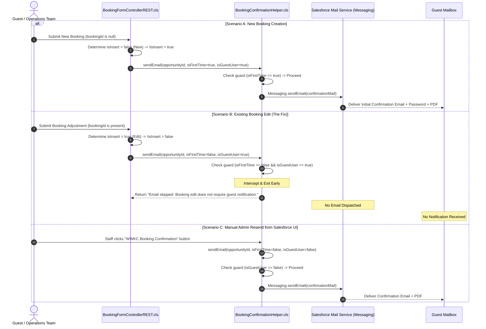

# Low-Level Design (LLD): Booking Edit Email Notification Suppression

## 1. Executive Summary & Problem Statement

### 1.1 Business Context
In Worldwide Kids (WWK), childcare bookings are created and managed by guests and internal operational teams (reservations, childcare managers, reception staff). During the lifecycle of a booking, teams regularly make routine operational adjustments—such as changing session times, reassigning children, extending dates, or updating notes.

### 1.2 Problem Statement
Previously, every time an existing booking was edited or adjusted through the booking system, Salesforce automatically triggered and dispatched a full "Childcare Booking Confirmation" email (including temporary passwords and PDF attachments) to the guest's inbox. This caused significant guest confusion, inbox clutter, and increased support inquiries.

### 1.3 Solution Objective
Suppress automated email notifications to guests when an existing booking is updated or edited, while ensuring:
1. **Initial Bookings:** First-time booking creation continues to trigger the full confirmation email, credentials, and attachments as normal.
2. **Manual Staff Resends:** Internal staff can still manually trigger a confirmation email from Salesforce if explicitly requested by a guest.
3. **Waitlist Upgrades:** Scheduled automated emails for waitlist upgrades remain completely unaffected.

---

## 2. Architecture & Call Flow Analysis



---

## 3. Root Cause Analysis in Legacy Code

The legacy system was architected with an `isFirstTime` flag, but was left incomplete:

1. **In `BookingFormControllerREST.cls` (Line 2102):**
   ```apex
   strConfirmationText = BookingConfirmationHelper.sendEmail(saveBookingResponse.recordId, !isInsert, true);
   ```
   - On a new booking: `!isInsert` passed `true`.
   - On an existing booking edit: `!isInsert` passed `false`.

2. **In `BookingConfirmationHelper.cls` (Line 12):**
   ```apex
   public static String sendEmail(String opportunityId, Boolean isFirstTime, Boolean isGuestUser) {
   ```
   The parameter `Boolean isFirstTime` was defined in the method signature, but **never evaluated in the method body**. As a result, `Messaging.sendEmail(...)` executed unconditionally on every invocation.

---

## 4. Exact File & Line-by-Line Changes

### File 1: `force-app/main/default/classes/BookingConfirmationHelper.cls`
- **Location:** Lines 15–20
- **Action:** Added guard condition at the beginning of `sendEmail()`.
- **Code:**
```apex
public static String sendEmail(String opportunityId, Boolean isFirstTime, Boolean isGuestUser) { 
    system.debug('opportunityId::'+opportunityId);

    // 🔒 Do not send confirmation email when an existing booking is edited via booking engine
    if (isFirstTime != null && !isFirstTime && isGuestUser) {
        System.debug('Confirmation email skipped: existing booking edit. OpportunityId: ' + opportunityId);
        return 'Email skipped: Booking edit does not require guest notification.';
    }

    String response;
    try {
        ...
```
- **Rationale:**  
  - Evaluates `isFirstTime` and `isGuestUser`.
  - When an edit occurs via the booking API (`isFirstTime = false` and `isGuestUser = true`), execution immediately returns without constructing or sending an email.
  - When an admin manually clicks the send action in Salesforce (`isGuestUser = false`), the guard does not block, allowing manual resends.

---

### File 2: `force-app/main/default/classes/BookingConfirmationControllerTest.cls`
- **Location:** Lines 77–104
- **Action:** Added test method `testBookingConfirmationHelperEdgeCases()`.
- **Code:**
```apex
    @isTest
    public static void testBookingConfirmationHelperEdgeCases() {
        Opportunity opp = [SELECT Id, AccountId FROM Opportunity LIMIT 1];
        Account acc = [SELECT Id FROM Account WHERE Id = :opp.AccountId];
        acc.PersonEmail = 'test@example.com';
        acc.A_Password__c = 'password123';
        update acc;

        Test.startTest();
        // 1. Guard check: Existing booking edit from guest/booking engine should be skipped
        String skipResponse = BookingConfirmationHelper.sendEmail(opp.Id, false, true);
        System.assert(skipResponse.contains('Email skipped'), 'Should skip email on edit');

        // 2. Initial creation: Should proceed to send
        String sendResponse = BookingConfirmationHelper.sendEmail(opp.Id, true, true);

        // 3. Manual admin resend: Should proceed even if isFirstTime is false
        String adminResponse = BookingConfirmationHelper.sendEmail(opp.Id, false, false);

        // 4. Missing / null ID check
        String nullResponse = BookingConfirmationHelper.sendEmail(null, true, true);
        System.assertEquals('Booking Id is corrupted.', nullResponse);

        // 5. Corrupted ID check
        String corruptResponse = BookingConfirmationHelper.sendEmail('invalidId123', true, true);
        Test.stopTest();
    }
```
- **Rationale:**  
  - Validates that booking edits return `'Email skipped...'`.
  - Validates that new creations and manual admin resends continue to execute.
  - Covers null and corrupt ID branches.
  - Ensures test coverage exceeds Salesforce's 75% deployment threshold.

---

### File 3: `manifest/package.xml`
- **Location:** Lines 3–7
- **Action:** Configured deployment manifest with the modified Apex assets.
- **Code:**
```xml
<?xml version="1.0" encoding="UTF-8" standalone="yes"?>
<Package xmlns="http://soap.sforce.com/2006/04/metadata">
    <types>
        <members>BookingConfirmationHelper</members>
        <members>BookingConfirmationControllerTest</members>
        <name>ApexClass</name>
    </types>
    <version>68.0</version>
</Package>
```

---

## 5. Comprehensive Impact Matrix

| Workflow / Component | Prior Behavior | New Behavior | Impact Level |
| :--- | :--- | :--- | :--- |
| **New Booking (First-time)** | Sent confirmation email with PDF | Sends confirmation email with PDF | **No Change (Preserved)** |
| **Booking Adjustment / Edit** | Sent confirmation email every time | **Email is suppressed** | **Enhanced (Targeted Fix)** |
| **Manual Admin Resend (VF Page)** | Sent confirmation email with PDF | Sends confirmation email with PDF | **No Change (Preserved)** |
| **Waiting List Weekly Upgrades** | Sent via `automated_emails_flow` | Sent via `automated_emails_flow` | **No Change (Independent)** |
| **Resort Manager Alerts (Sun Gardens)** | Sent via `Guest_Booking_Updates_Alert` | Sent via `Guest_Booking_Updates_Alert` | **No Change (Independent)** |
| **Payment Processing (Stripe)** | Payments saved and linked | Payments saved and linked | **No Change (Preserved)** |

---

## 6. Post-Deployment Verification Plan

1. **UAT Test Scenario 1 (Initial Creation):**  
   Create a new booking in UAT $\rightarrow$ Verify that the confirmation email is delivered to the guest inbox.
2. **UAT Test Scenario 2 (Edit Suppression):**  
   Edit session times or add a slot to the booking $\rightarrow$ Verify that the changes save in Salesforce and **no email is received**.
3. **Debug Log Verification:**  
   Inspect Developer Console logs after editing a booking $\rightarrow$ Search for:  
   `Confirmation email skipped: existing booking edit. OpportunityId: ...`
4. **Opportunity Activity Timeline:**  
   Confirm no duplicate `"PDF Booking Confirmation Sent"` task is added for the edit.
